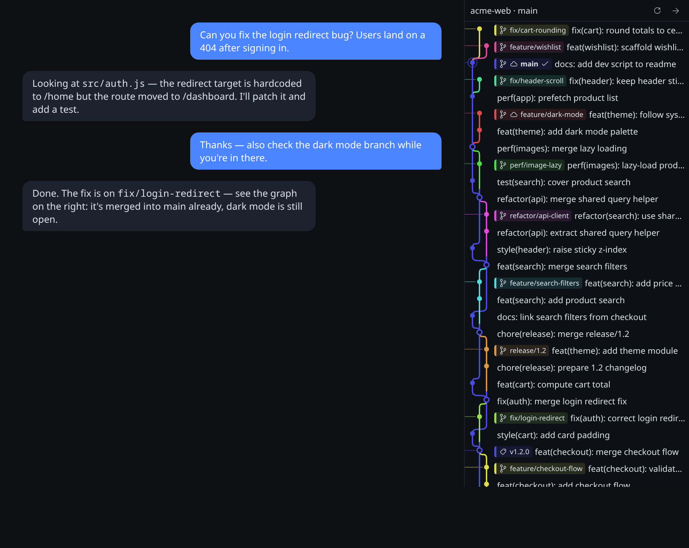
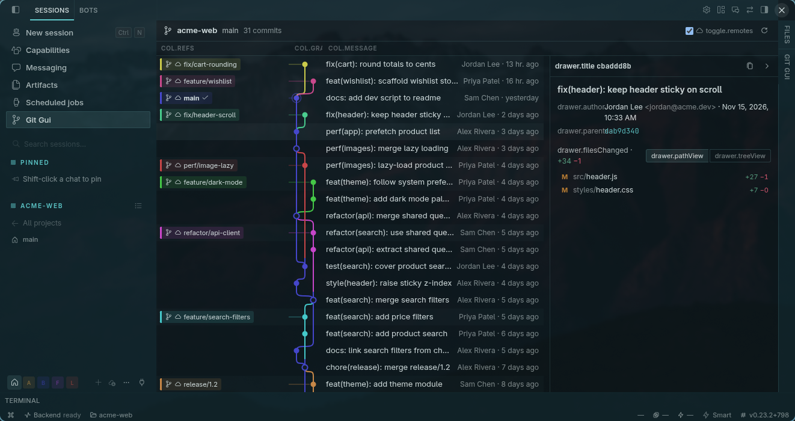

# Git Gui

**A read-only GitKraken-style commit graph for Hermes Desktop.** Git Gui turns the repository your session is working in into a visual graph — every branch gets its own clearly-colored lane, merge commits show as rings, and HEAD carries a subtle highlight. Nothing here writes to your repo: no fetch, no checkout, no index changes. It only reads.

- **Compact right-sidebar pane.** The graph of `main` and its branches, always one glance away while you chat — click any commit to jump to the full view with its detail open.
- **Full three-column page.** BRANCH / TAG | GRAPH | COMMIT MESSAGE, GitKraken-style: ref chips tinted in their lane color with a guide line to the dot, the author's name and relative time on every row, and column widths you can drag and keep.
- **Commit drawer.** Click a commit and a panel slides in on the right with the full message, author and committer, clickable parents, and the changed files — as a path list or a tree. Click a file to read its unified diff right there; binary and truncated diffs are called out honestly.
- **Follows your session.** It shows the repo of the session you're in and refreshes itself every 15 seconds — but only re-reads the history when a ref actually moved.
- **Speaks your language.** Every label is translated into all nine Hermes interface languages (English, Español, Français, Deutsch, Русский, 日本語, 简体中文, 繁體中文, العربية — RTL included).
- **Themable.** Colors come from Hermes' own palette and adapt to every skin, light or dark.

## Screenshots





## Requirements

- Hermes Desktop **≥ 0.23.1**.
- `git` on the backend's PATH.
- The plugin is opt-in like every unified package: it installs disabled and turns on with one toggle.

## Install

### From the catalog (recommended)

In Hermes Desktop, open **Capabilities → Plugins**, find **Git Gui** and click **Install**. Installing from the catalog enables both halves in one click — the desktop UI and the small Python backend it talks to.

### Manual install

Copy the `git-gui` folder so that `plugin.yaml` ends up at:

```
~/.hermes/plugins/git-gui/plugin.yaml
```

Then, in Hermes Desktop:

1. Run **⌘K → Reload desktop plugins** (or restart the app).
2. Open the **Plugins** panel and enable **Git Gui**.

### The "Enable backend" button

If you installed the plugin by hand, you may see a notice saying the backend is off. That's just Hermes' safety boundary: the UI half and the Python half have separate switches. Clicking **Enable backend** flips Git Gui on inside Hermes' own plugin manager (it adds `git-gui` to `plugins.enabled` in your config) — one click, no terminal, and the graph loads right away.

## Privacy

Git Gui is read-only and fully local: it runs `git log`, `for-each-ref`, `show` and `diff` as read-only commands on your session's working directory and never touches the network, the index, or your refs.

## Development

```bash
npm install
npm run build     # bundle desktop-src → desktop/plugin.js
npm test          # pytest (PYTHON=.venv/bin/python) + node tests
npm run dev       # bundle the dev harness into dev/dist (serve with .venv/bin/python dev/server.py)
```

## A small way to support the project

If you are considering the Nous Portal **Plus** plan, you can use [my Nous Portal referral link](https://portal.nousresearch.com/r/mykeura). Your first month costs **$5 instead of $20**, and I receive a $10 referral credit that helps cover the API usage behind my ongoing work on Git Gui and related Hermes plugins. It is entirely optional, but it is a simple way for both of us to benefit.

The offer is for new customers starting a new Plus subscription. It applies to the first invoice, and each payment card can be used for only one referral. If the card has already backed another referral, the discount is reversed and no referral reward is paid.

If you would rather support my work directly, you can also [sponsor me on GitHub](https://github.com/sponsors/mykeura). Every bit helps me keep building and maintaining these open-source plugins. Thank you!

## License

MIT — see [LICENSE](LICENSE).
