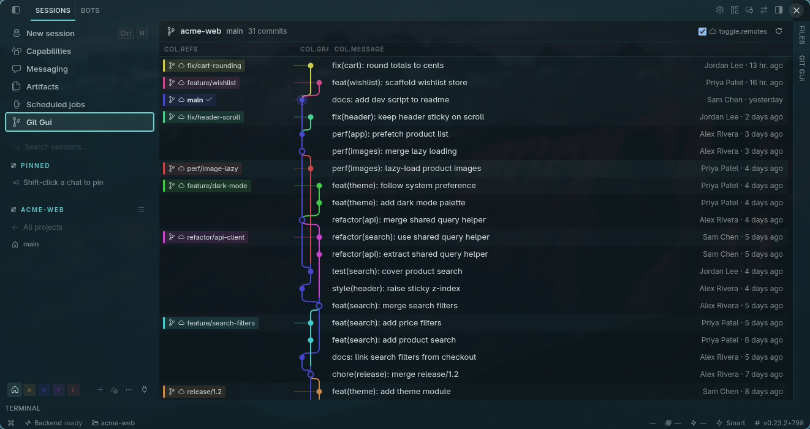
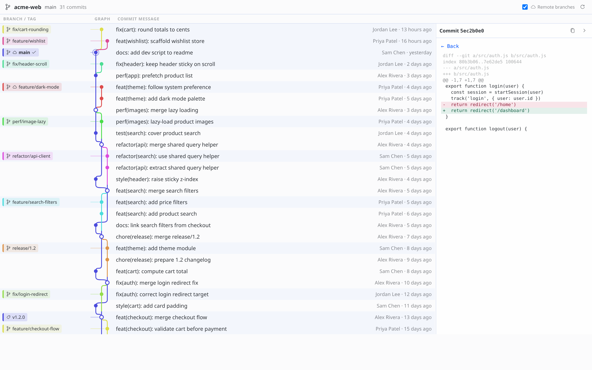

# Git Gui

**A read-only commit graph for Hermes Desktop, inspired by modern graphical Git clients.**



Git Gui turns the repository your chat is working in into a visual graph: every branch gets its own clearly-colored lane, merges show as rings, and HEAD carries a subtle highlight. It only ever reads your repository — nothing here writes to it.

## Features

- **Compact right-sidebar pane** — the graph at a glance while you chat; click a commit to jump to the full view.
- **Full three-column page** — BRANCH / TAG | GRAPH | COMMIT MESSAGE with draggable column widths, ref chips colored by lane, and author + relative time on every row.
- **Commit drawer** — full message, author/committer, clickable parents, changed files (Path or Tree view), and a unified diff per file.
- **Follows your session** — shows the repo of the chat you're in; polls every 15 s and only re-reads history when a branch or tag actually moves.
- **Nine languages, every theme** — translated into all Hermes interface languages (RTL included) and colored from the app's own palette.

## Screenshots


*The right-sidebar pane: the graph of main and its branches while you work.*



*Click a file in the drawer to read its diff — binary and truncated diffs are called out.*

## Requirements

- Hermes Desktop **≥ 0.23.1**
- `git` installed on the backend's PATH

## Install

### From the catalog (recommended)

Open **Capabilities → Plugins**, find **Git Gui** and click **Install**. One click enables both halves — the desktop UI and the small Python backend it talks to.

### Manual install

Copy the `git-gui` folder so that `plugin.yaml` ends up at `~/.hermes/plugins/git-gui/plugin.yaml`, then:

1. Run **⌘K → Reload desktop plugins** (or restart the app).
2. Open **Capabilities → Plugins** and enable **Git Gui**.

## Getting started

- Click **Git Gui** at the end of the left sidebar's top block, open the pane in the right sidebar, or run **Git Gui: Open** from ⌘K (Ctrl+K).
- It always shows the working folder of the chat you're in — switching chats switches repos.

## Using Git Gui

- **Reading the graph:** one color per branch line — they stay distinct even for branches merged one after another — and the main branch is always first in blue. Plain dots are commits, rings are merges, and HEAD gets an extra ring. Chips mark branches (check = current), a cloud marks a remote branch, and a tag icon marks a tag.
- **Columns:** drag the dividers between BRANCH / TAG, GRAPH and COMMIT MESSAGE — widths are remembered. The **Remote branches** toggle in the header shows or hides remote-only refs.
- **The drawer:** click a commit to open it. Copy the full hash, jump to a parent commit, switch files between Path and Tree, and click a file to see its diff. Binary files and truncated diffs are labeled as such.
- **Keyboard:** ↑/↓ moves the selection, Enter opens the drawer, Esc closes it.
- **Refreshing:** the graph re-checks every 15 seconds but only reloads history when refs change. The **Refresh** button forces it. More history loads automatically as you scroll.

## FAQ & troubleshooting

**"Backend is disabled" / Enable backend button** — the UI and the Python backend have separate switches. Clicking **Enable backend** turns Git Gui on inside Hermes' own plugin manager (it adds `git-gui` to `plugins.enabled` in your config). One click, safe, no terminal.

**"Not a git repository"** — the chat's working folder isn't inside a git repo.

**"No working directory"** — no chat is open, or the chat has no working folder attached.

**"git is not installed"** — Git Gui needs the `git` executable on the backend's PATH.

**Does it change my repository?** No — it only runs read-only git commands (`log`, `for-each-ref`, `show`, `diff`).

**Does it send my code anywhere?** No — everything stays local; it never touches the network.

**Big repositories?** History loads in pages of 500 commits as you scroll, so even very large repos stay fast.

**A red "Session controls unavailable: Session owner could not be resolved…" strip?** That message comes from Hermes itself when reopening an older chat whose owner can't be resolved on multi-profile setups. It's unrelated to Git Gui and appears even with the plugin disabled.

**Disable / uninstall / update** — toggle it off in **Capabilities → Plugins**; delete `~/.hermes/plugins/git-gui/` to remove it; updates arrive through the catalog with `hermes plugins update git-gui`.

## Privacy

Fully local and read-only. No telemetry, no network calls — just git running in your session's working directory.

## Languages

English, Español, Français, Deutsch, Русский, 日本語, 简体中文, 繁體中文, العربية.

## Development

```bash
npm install
npm run build        # bundle desktop-src → desktop/plugin.js
PYTHON=.venv/bin/python npm test   # pytest + node tests
npm run dev          # build the dev harness (serve: .venv/bin/python dev/server.py)
npm run smoke        # rebuild harness; run ?smoke=1 checks in a browser
npm run screenshots  # regenerate images/ with headless Chromium
```

## A small way to support the project

If you are considering the Nous Portal **Plus** plan, you can use [my Nous Portal referral link](https://portal.nousresearch.com/r/mykeura). Your first month costs **$5 instead of $20**, and I receive a $10 referral credit that helps cover the API usage behind my ongoing work on Git Gui and related Hermes plugins. It is entirely optional, but it is a simple way for both of us to benefit.

The offer is for new customers starting a new Plus subscription. It applies to the first invoice, and each payment card can be used for only one referral. If the card has already backed another referral, the discount is reversed and no referral reward is paid.

If you would rather support my work directly, you can also [sponsor me on GitHub](https://github.com/sponsors/mykeura). Every bit helps me keep building and maintaining these open-source plugins. Thank you!

## License

MIT — see [LICENSE](LICENSE).
